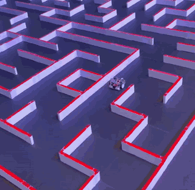
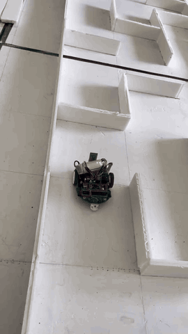
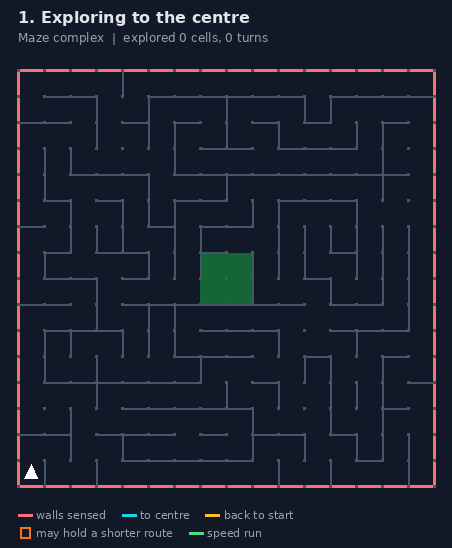
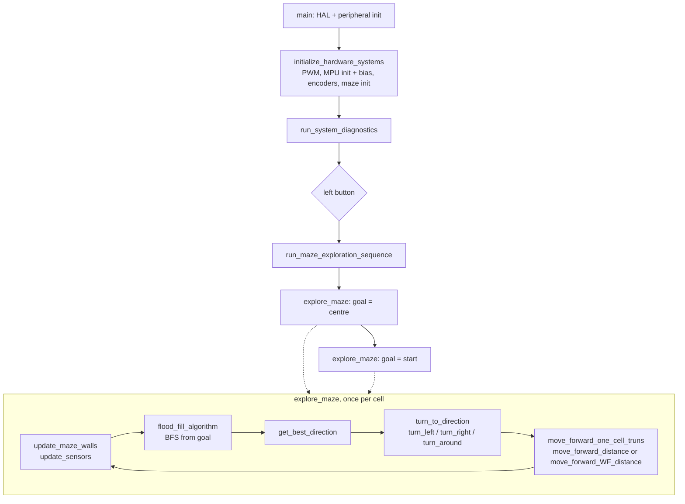

# Micromouse Robot

Firmware, PCB and CAD for a 16×16 classic micromouse built on an
STM32F411CEU6. The robot explores the maze from the start corner to the
centre with flood fill. On the way back it checks other routes until the
shortest path is proven, then runs that path start to centre.

<p align="center">
  <a href="docs/media/robofest-2025-finals.mp4"></a>
  <a href="docs/media/arena-testing.mp4"></a>
  
</p>
<p align="center"><em>Left: Robofest 2025 finals run (3× speed). Middle: testing in our arena (2× speed). Click either clip for the full video. Right: the team at the Robofest 2025 finals.</em></p>

- Firmware: STM32CubeIDE project (`Micromouse-Robot.ioc`, `Core/`, `Drivers/`)
- Electronics: Altium schematics (`*.SchDoc`), PCB (`PCB1.PcbDoc`, `PCB/`),
  fabrication outputs (`Project Outputs for micromouse_F411.zip`), schematic
  PDF (`micromouse_F411.pdf`)
- Mechanics: STEP models (`micromouse.step`, `mouse_with_holes.step`)
- Tuning tools: Python scripts and CSV logs in `Core/`
- Maze simulator for the exploration logic: `tools/sim/`

<p align="center"></p>

The firmware's maze logic running in the host simulator (`tools/sim`,
`make gif`) on a demo maze with two routes to the centre:

1. **Out (cyan):** the robot finds route A, up the west side and along the
   top, 27 cells.
2. **Back (amber):** A is the only known path, so cells that could hold a
   shorter route (orange boxes) are still unchecked. The robot returns along
   a new route B, across the bottom and up the right side.
3. **Speed run (green):** the shortest path through everything it has seen
   is B's first part plus A's last few cells, 25 cells.

Red: walls the robot has sensed. Blue shading: flood fill distance to the
current goal.

Detailed per-function notes: [Function Reference & Debug Guide](<Micromouse – Function Reference & Debug.md>).

## Hardware

| Block | Part | MCU resources |
|---|---|---|
| MCU | STM32F411CEU6, 84 MHz from HSI (16 MHz / 16 × 168 / 2) | |
| Motor driver | DRV8833 | TIM3 CH1–CH4 PWM on PA6, PA7, PB0, PB1 (≈20 kHz, ARR = 838); STBY on PC13 |
| Encoders | 2 × quadrature | Left: TIM2 (PA15, PB3). Right: TIM4 (PB6, PB7). Both 16-bit, encoder mode TI12 |
| IR emitters | 4 × SFH4545 | Front-left PB9, front-right PA8, side-left PA9, side-right PB8 (GPIO) |
| IR receivers | 4 × TEFT4300 | ADC1: front-left CH5 (PA5), front-right CH2 (PA2), side-left CH4 (PA4), side-right CH3 (PA3) |
| Battery sense | divider | ADC1 CH0 (PA0) |
| IMU | MPU9250 family (answers WHO_AM_I = 0x70) | SPI2, CS on PB12; ±500 °/s gyro, only Z axis used |
| Bluetooth | serial module | USART6 TX PA11 / RX PA12, **9600 baud** |
| Speaker | buzzer | TIM1 CH3 PWM on PA10 |
| LEDs | 2 | PB4 (left), PB5 (right) |
| Buttons | 2 | PA1 left (EXTI1), PB10 right (EXTI15_10) |

Pin names are defined in `Core/Inc/main.h` (generated from the `.ioc` file).

## Build and flash

**STM32CubeIDE:** import the folder as an existing project, build the
`Debug` configuration and flash with ST-LINK
(`Micromouse-Robot Debug.launch`). `Debug/` is generated by the IDE and is
not tracked in git.

**Command line:** CubeIDE writes machine-specific makefiles into `Debug/`, so
there is no portable makefile. Compile every file in `Core/Src/` and
`Drivers/STM32F4xx_HAL_Driver/Src/` plus `Core/Startup/startup_stm32f411ceux.s`
with `arm-none-eabi-gcc` 13.x and these flags, then link with
`STM32F411CEUX_FLASH.ld`:

```
-mcpu=cortex-m4 -mthumb -mfpu=fpv4-sp-d16 -mfloat-abi=hard --specs=nano.specs
-std=gnu11 -O0 -g3 -DDEBUG -DUSE_HAL_DRIVER -DSTM32F411xE
-ICore/Inc -IDrivers/STM32F4xx_HAL_Driver/Inc -IDrivers/STM32F4xx_HAL_Driver/Inc/Legacy
-IDrivers/CMSIS/Device/ST/STM32F4xx/Include -IDrivers/CMSIS/Include
-ffunction-sections -fdata-sections -Wall
# link: --specs=nosys.specs -Wl,--gc-sections -u _printf_float -lc -lm
```

### Build switches

| Macro | Default | Effect |
|---|---|---|
| `TELEMETRY_LEVEL` | `1` | Bluetooth output during exploration. `0` silent, `1` milestones and errors, `2` every move, turn, wall reading and a maze dump every 5 steps (old behaviour). |
| `AUDIO_FEEDBACK` | `0` | `1` enables the 50 ms wall beep and 30 ms turn beep on every cell. |

Set them with `-D...` in *Project → Properties → C/C++ Build → Settings →
MCU GCC Compiler → Preprocessor*, or change the defaults in
`Core/Inc/micromouse.h`.

At 9600 baud each byte blocks the robot for about 1 ms. With level 2 the
robot stands still for roughly 0.4 s per cell just sending text.

## Operating the robot

1. Place the robot in the start cell (bottom-left, facing north) and power on.
2. Keep it still: it calibrates the gyro bias during start-up (about 2 s after
   "KEEP ROBOT STATIONARY").
3. Press the **left** button. The robot explores to the centre, plays the
   success tone, then drives back to start, checking other routes on the way.
4. Press the **left** button again for the speed run: shortest known path
   from start to centre. For another speed run, carry the robot back to the
   start cell facing north and press again.
5. **Right** button before or after a run prints a status report (maze
   distances, sensors, encoders). The emergency-stop branch only runs between
   runs, because exploration blocks the main loop.

Connect a serial terminal at 9600 baud to the Bluetooth module to read the
output.

## Software architecture



| File | Role |
|---|---|
| `Core/Src/main.c` | CubeMX init code, start-up sequence, button handling (`HAL_GPIO_EXTI_Callback`) |
| `Core/Src/micromouse.c` | Maze state, flood fill, direction choice, exploration loop, `dwt_delay_us()` |
| `Core/Src/movement.c` | Motor output, encoder totals, straight gyro PID, in-place gyro turn, turn primitives |
| `Core/Src/wall_handle.c` | Front-wall alignment, side-wall PID with ADC→distance tables, wall + gyro fusion |
| `Core/Src/sensors.c` | Emitter-synchronised IR reads, wall flags, calibration and diagnostics |
| `Core/Src/gyro.c` | MPU9250 SPI driver, Z-axis bias calibration |
| `Core/Src/communication.c` | Bluetooth text output, maze dump, status reports |
| `Core/Src/audio.c` | Tones on the speaker |
| `Core/Src/utils.c` | LED sequences, health check, small helpers |
| `Core/Src/logging_tests.c` | Step and relay tests that stream CSV for PID identification |

### Exploration algorithm

- Unknown walls count as open (optimistic flood fill). Boundary walls are set
  at start.
- Each cell: read the three visible walls, store them in both neighbouring
  cells, rerun a breadth-first flood fill from the goal (the four centre cells,
  or the start cell on the way back).
- `get_best_direction()` moves to the open neighbour with the **lowest
  distance**. Ties go to the least visited cell, then forward, right, left,
  back. Preferring forward avoids a stop-and-turn.
- **Return trip proves the shortest path.** The known shortest path uses
  only visited cells. The optimistic one treats unknown walls as open, so it
  is never longer than the true shortest path. While the known path is longer,
  a shorter route may exist through some unvisited cell where
  distance-from-start + distance-to-centre equals the optimistic length.
  The return flood fill targets those cells first
  (`seed_unproven_route_cells()`). When the two lengths match, the robot
  heads home.
- **Speed run** (`run_speed_run()`): plans over visited cells only, then
  drives start → centre with the same turn and move functions as exploration,
  preferring straight at ties. It runs at exploration speed. The gain is the
  shortest route with no detours.
- Safety limit: `MAZE_SIZE² × 3` moves per phase.

### Motion controllers

| Controller | Where | What it does |
|---|---|---|
| Straight, gyro | `moveStraightGyroPID()` in `movement.c` | PID on Z rate (target 0 °/s), base PWM 570, correction split left/right. Used by `move_forward_distance()` until either wheel reaches its encoder target. |
| Straight, walls | `wall_follow_step()` in `wall_handle.c` | Side sensor ADC → cm with lookup tables, PID on distance to a 2.5 cm target from the visible wall. Used by `move_forward_WF_distance()` (base PWM 600). |
| Turn in place | `turn_in_place_gyro()` in `movement.c` | Integrates gyro yaw, desired rate from a braking law `ω = √(2·α·|error|)` capped at 300 °/s, inner rate PID plus feed-forward, settles within 1° and 20 °/s. |
| Front align | `align_front_to_wall()` in `wall_handle.c` | Two PI loops on the front sensors: distance (average) and angle (difference) to a target reading of 80; used before a turn when a front wall is seen. |
| Fusion | `fusion_step()` in `wall_handle.c` | Blends wall PID and a gyro heading hold by how many side walls are visible. Available, not used by exploration. |

Each cell move ends with `break_motors()` (20 ms active brake, then coast).

## Tuning parameters

All values were tuned on the real robot. Change them only with on-track tests.

| Parameter | Value | Location |
|---|---|---|
| Encoder counts per cell | 2460 / 2460 | `Core/Inc/micromouse.h:32` |
| Wall thresholds FL / FR / SL / SR | 6 / 6 / 11 / 14 | `Core/Inc/micromouse.h:37` |
| Post-turn first-cell counts (L, R) | right 1549/1537, around 1530/1562, left 1330/1352 | `Core/Src/micromouse.c:259` |
| First move from start | 1200 counts | `Core/Src/micromouse.c:342` |
| Pre-turn move when no front wall | 957 counts | `Core/Src/movement.c:112` |
| Turn call | ±90°, base 520 (clamped to 400 inside), 1200 ms timeout | `Core/Src/movement.c:119` |
| Straight gyro PID `Kp_g, Ki_g, Kd_g` | 0.437, 1.515, 0.0189 | `Core/Src/movement.c:451` |
| Straight base PWM | 570 | `Core/Src/movement.c:523` |
| Turn shaping `OMEGA_MAX_DPS`, `ALPHA_MAX_DPS2`, `ANGLE_TOL_DEG` | 300, 3000, 1.0 | `Core/Src/movement.c:560` |
| Wall PID `WF_KP, WF_KD` | 0.13, 0.002 | `Core/Src/wall_handle.c:155` |
| Wall target distance | 2.5 cm | `Core/Src/wall_handle.c:215` |
| Front align target / gains | 80; Kp_d 30, Ki_d 0.3, Kp_a 10.5, Ki_a 0.1 | `Core/Src/wall_handle.c:24` |
| IR emitter settle times | 50 µs front, 80 µs side | `Core/Src/sensors.c:189` |

## Hardware workarounds (intentional)

These look odd but make the robot drive correctly on this hardware. Do not
"clean them up" without testing on the track.

- **`motor_set()` channel handling.** Some branches write the "low" side of
  the H-bridge with `HAL_GPIO_WritePin` on a pin that is in TIM3 PWM mode,
  so that write has no effect and the other channel keeps its last duty. The
  tuned turns and alignments depend on this behaviour.
- **Shorter first cell after a turn.** Every turn starts with a 957-count
  forward move or a front-wall alignment, so the next cell uses tuned counts
  per turn type (`pending_left_counts` / `pending_right_counts`).
- **First move from start** uses 1200 counts, not a full cell.
- **Front-wall alignment before turns** when a front wall is seen, to cancel
  heading and distance errors.
- **`break_motors()`** holds both bridge inputs high for 20 ms, then coasts.
- **`system_ready` forced true** in `run_system_diagnostics()` so the robot
  can start even when the health check reports a warning.

## Maze simulator

`tools/sim/` compiles the real `micromouse.c`, `communication.c`, `audio.c`
and `utils.c` on a PC, with motion and sensors replaced by a virtual robot in
a known maze. It measures the decision logic and idle time, not motion. See
[tools/sim/README.md](tools/sim/README.md).

```sh
cd tools/sim && make && ./build/sim --random 200 1
```

Mean per run, original firmware → current:

| Maze set | Exploration cells | 90° turns | 180° turns | UART blocked | `HAL_Delay` | Known path vs true shortest | Speed run |
|---|---|---|---|---|---|---|---|
| 200 generated mazes | 222.6 → 133.4 | 128.8 → 77.8 | 8.7 → 3.8 | 89.5 s → 0.8 s | 26.5 s → 10.5 s | +0.53 → **0** cells | 200/200 optimal, 42.9 cells |
| 523 classic contest mazes¹ | 242.6 → 250.2 | 107.2 → 109.2 | 11.9 → 12.6 | 96.6 s → 0.8 s | 27.0 s → 11.7 s | +1.44 → **0** cells | 523/523 optimal, 59.3 cells |

¹ From [micromouseonline/mazefiles](https://github.com/micromouseonline/mazefiles) `classic/`, not included here. One more file has no path to the centre and is not counted.

On classic mazes, exploration now drives about 3 % more cells than the
original firmware. In exchange, the robot always ends with the true shortest
path, and the speed run drives it.

## PID identification tools

`logging_tests.c` streams CSV over Bluetooth while it applies PWM steps
(`run_gyro_step_test()`, `run_encoder_step_test()`, `run_gyro_turn_step_test()`,
`run_wall_lateral_step_test()`, `run_wall_single_left_step_test()`,
`run_wf_relay_test()`). The scripts in `Core/` fit models to those logs and
suggest gains.

| Script | Purpose |
|---|---|
| `gyro_pid_ident.py` | Gyro rate-loop PID identification from `run_gyro_step_test()` logs |
| `gyro_turns.py` | FOPDT fit of yaw rate from turn step tests, IMC PI gains |
| `pid.py` | General step-response PID tuner (`python pid.py <csv>`) |
| `wall_follow_pid.py` | Wall-follow PID estimate from wall test logs |
| `wall_pid_autotune.py` | Wall-follow autotune (`--csv`, columns `t_ms,u,e`); result in `wall_autotune_result.txt`, plot in `wall_autotune_preview.png` |

| Logs | Columns |
|---|---|
| `log_gyro.csv`, `log_gyro_turns*.csv`, `step1-4.csv` | `t_ms, left_pwm, right_pwm, gyro_z, left_counts, right_counts, left_rate, right_rate` |
| `log_encoder*.csv` | `t_ms, left_pwm, right_pwm, left_counts, right_counts, left_rate, right_rate` |
| `wall.csv`, `wall2.csv` | `t_ms, u, e, L, FL, FR, Lpwm, Rpwm, left_cnt, right_cnt` |

Call a test from `USER CODE BEGIN 2` in `main.c` (examples are listed there),
save the serial output as CSV and pass it to the script. The scripts need
`numpy`; some also use `pandas` and `matplotlib`.

## Known limitations and next steps

- Every cell ends with a full stop, sensor read and flood fill, also in the
  speed run. Continuous moves, diagonals and higher speed on the speed run
  are the next big gains; all of them need on-track tuning.
- The speed run and the path-proving return trip are tested in the simulator
  only, not yet on the robot.
- `turn_in_place_gyro()` uses the straight-line gains `Kp_g/Ki_g/Kd_g` in its
  rate loop. The separately identified `Kp_t/Ki_t/Kd_t` are not used.
- `turn_in_place_gyro()` clamps `base_pwm` to 60…400, so the 520 passed by the
  turn functions acts as 400.
- TIM3 period is 838, so PWM commands above 838 (clamps at 1000/1200, brake
  at 1000) are all 100 % duty.
- Dynamic (calibrated) wall thresholds are disabled in `update_sensors()`;
  the static thresholds in `micromouse.h` are used.
- Bluetooth output is blocking (`HAL_UART_Transmit`, 1000 ms timeout). A
  DMA or interrupt TX buffer would remove the remaining wait.
- Exploration runs inside the main loop, so the right-button emergency stop
  is not checked during a run.

## Contributors

rivindu02, Praveen-samuditha, Mohammed Aashir.
